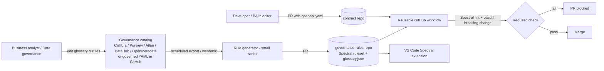

# Data Governance for API Contracts — Buy/Reuse Instead of Build

> Context: The EA decision "API Management Platform - AD-001 - OpenAPI Tooling" selected Alternative 2
> (a custom "Integration Contract Studio"). This document proposes a COTS/open-source-first
> approach that keeps the same outcomes (contract-first, governance validation, CI enforcement,
> usable by non-developers) while minimising custom code. It follows "Reuse before Buy before Build" (AD-001 EA).

## 1. Goal

- Data governance workers and business analysts **own the rules** (field names, types, formats, PII classification) without writing code.
- Contracts live as YAML in GitHub (contract-first).
- CI **rejects** PRs where fields or contracts deviate from governance.
- Same validation runs in the IDE (fast feedback) and in the pipeline (enforcement).

## 2. Target Architecture



## 3. Avoiding a Custom Tool — Options

| Need | Off-the-shelf answer | Custom code needed |
|---|---|---|
| Rule engine for OpenAPI/AsyncAPI | **Spectral** (OSS) — same as SwaggerHub validation | Ruleset only (config) |
| Governance vocabulary owned by non-devs | Existing governance catalog (Collibra/Purview/Atlan) or **DataHub/OpenMetadata** glossary; fallback: `glossary.yaml` edited via GitHub web UI with CODEOWNERS = governance team | Small export script |
| Business-analyst-friendly editing | **Redocly/Scalar/Swagger Editor**, VS Code web (github.dev), or Apidog/Postman if Alt. 3 market research selects one; BAs can also edit glossary rows rather than contracts | None |
| Breaking-change detection | **oasdiff** or **Optic** | None |
| Review/comments | **GitHub PRs** (replaces SwaggerHub review) with CODEOWNERS for governance approval | None |
| Event contracts (NDP/Kafka) | **Schema registry compatibility modes** + AsyncAPI linted with Spectral | None |
| IDE feedback | **Spectral VS Code extension**, Copilot + MCP serving the glossary | Optional MCP wrapper |
| Enforcement | **Required status check** via reusable GitHub workflow | One workflow |
| Exceptions | `x-governance-exception` extension reviewed by governance CODEOWNERS | None |

### How governance people work without code

1. Governance owns `glossary.yaml` (or the catalog). A change = PR (or catalog approval) reviewed by governance.
2. A generator converts it to Spectral rules automatically — nobody hand-writes rules.
3. Contract repos pull the latest ruleset by version tag (semantic versioning, immutable).
4. Deviations show up as PR check failures with human-readable messages.

### Recommended minimal custom surface (everything else is COTS)

- `generate-rules.mjs` (~50 lines): glossary -> Spectral rules.
- One reusable workflow.
- Optional: MCP server exposing glossary lookup to Copilot.

Estimated maintenance is a fraction of the 2 MM + 3–4 MM/year in AD-001 for the editor and MCP servers.

## 4. Sample Governance Glossary (owned by governance)

`governance-rules/glossary.yaml`

```yaml
terms:
  - name: customerId
    type: string
    format: uuid
    classification: personal
    description: Unique customer identifier
  - name: isin
    type: string
    pattern: "^[A-Z]{2}[A-Z0-9]{9}[0-9]$"
    classification: internal
    description: ISIN of the security
  - name: maturityDate
    type: string
    format: date
    classification: internal
    description: Bond maturity date
forbidden:
  - name: cpr
    reason: Use customerId; CPR must not appear in contracts
  - name: ssn
    reason: Use customerId
```

## 5. Sample Spectral Ruleset

`governance-rules/.spectral.yaml`

```yaml
extends: [[spectral:oas, recommended]]
functions: [glossaryType, forbiddenFields]
functionsDir: ./functions
rules:
  governance-path-kebab-case:
    description: Paths must be lowercase with hyphens
    severity: error
    given: $.paths[*]~
    then:
      function: pattern
      functionOptions:
        match: "^(/[a-z0-9{}-]+)+$"

  governance-path-versioned:
    description: Paths must start with /api/v{n}/
    severity: error
    given: $.paths[*]~
    then:
      function: pattern
      functionOptions:
        match: "^/api/v[0-9]+/"

  governance-no-verbs-in-path:
    description: Paths contain nouns only
    severity: warn
    given: $.paths[*]~
    then:
      function: pattern
      functionOptions:
        notMatch: "/(get|create|update|delete|execute)[A-Za-z-]*"

  governance-glossary-type:
    description: Properties named after a glossary term must use the governed type/format
    severity: error
    given: $..properties
    then:
      function: glossaryType

  governance-forbidden-fields:
    description: Fields forbidden by data governance
    severity: error
    given: $..properties
    then:
      function: forbiddenFields

  governance-description-required:
    description: Every property must have a description
    severity: warn
    given: $..properties[*]
    then:
      field: description
      function: truthy

  governance-api-key-security:
    description: X-API-KEY security scheme required
    severity: error
    given: $.components.securitySchemes
    then:
      function: schema
      functionOptions:
        schema:
          type: object
          minProperties: 1
```

`governance-rules/functions/glossaryType.js` (reads the generated `glossary.json`)

```js
import glossary from "../glossary.json" with { type: "json" };

export default (properties) => {
  const results = [];
  for (const [name, schema] of Object.entries(properties ?? {})) {
    const term = glossary.terms.find((t) => t.name === name);
    if (!term) continue;
    if (schema.type !== term.type || (term.format && schema.format !== term.format)) {
      results.push({
        message: `'${name}' must be type ${term.type}${term.format ? `/${term.format}` : ""} per data governance`,
        path: [name],
      });
    }
  }
  return results;
};
```

`governance-rules/functions/forbiddenFields.js`

```js
import glossary from "../glossary.json" with { type: "json" };

export default (properties) =>
  Object.keys(properties ?? {})
    .filter((n) => glossary.forbidden.some((f) => f.name.toLowerCase() === n.toLowerCase()))
    .map((n) => ({
      message: `Field '${n}' is forbidden: ${glossary.forbidden.find((f) => f.name.toLowerCase() === n.toLowerCase()).reason}`,
      path: [n],
    }));
```

## 6. Rule Generator Sketch

`governance-rules/scripts/export-glossary.mjs` — converts `glossary.yaml` (or a catalog API response) to `glossary.json`.

```js
import { readFileSync, writeFileSync } from "node:fs";
import { parse } from "yaml";

const src = process.env.GLOSSARY_SOURCE ?? "glossary.yaml";
// Swap this for a Collibra/Purview/DataHub API call if a catalog is the source of truth
const glossary = parse(readFileSync(src, "utf8"));
writeFileSync("glossary.json", JSON.stringify(glossary, null, 2));
```

## 7. Reusable Workflow (central repo, e.g. `example-org/api-contract-workflows`)

`.github/workflows/validate-contract.yml`

```yaml
name: Validate API contract
on:
  workflow_call:
    inputs:
      spec-path:
        type: string
        default: openapi/openapi.yaml
      rules-ref:
        type: string
        default: v1
jobs:
  validate:
    runs-on: ubuntu-latest
    steps:
      - uses: actions/checkout@v4
        with: { fetch-depth: 0 }

      - uses: actions/checkout@v4
        with:
          repository: example-org/governance-rules
          ref: ${{ inputs.rules-ref }}
          path: .governance

      - uses: actions/setup-node@v4
        with: { node-version: 22 }

      - name: Spectral lint (governance + API standards)
        run: |
          npm i -g @stoplight/spectral-cli
          spectral lint ${{ inputs.spec-path }} \
            --ruleset .governance/.spectral.yaml \
            --fail-severity=error

      - name: Breaking change check vs main
        run: |
          git show origin/main:${{ inputs.spec-path }} > /tmp/base.yaml || exit 0
          docker run --rm -v "$PWD:/w" -v /tmp:/t tufin/oasdiff \
            breaking /t/base.yaml /w/${{ inputs.spec-path }} --fail-on ERR
```

Consumer repo `.github/workflows/contract.yml`:

```yaml
on: pull_request
jobs:
  contract:
    uses: example-org/api-contract-workflows/.github/workflows/validate-contract.yml@v1
```

Make `contract` a **required status check** in branch protection. Add `CODEOWNERS`:

```
/openapi/        @example-org/api-owners
/glossary.yaml   @example-org/data-governance
```

## 8. Rollout Plan

1. Pilot: one contract repo; 10–15 rules; Spectral + oasdiff in CI (days, not months).
2. Governance reviews glossary format; decide source of truth (existing catalog vs. YAML in Git).
3. Add the generator; publish `governance-rules` with semver tags.
4. Roll out the reusable workflow as a required check; add IDE extension guidance.
5. Optional: Copilot MCP for glossary lookup; Alternative 3 market research (Redocly, Apidog, Scalar) for BA-friendly editing.
6. Reassess the custom editor only if gaps remain that BAs genuinely cannot cover via the above.

## 9. Points for the Architecture Council

- AD-001 requires validation in **both build pipeline and dev tools** — Spectral satisfies both from one ruleset.
- "No vendor lock-in" is preserved: YAML in GitHub, open rule format.
- Reduces the "not a standard solution" con of Alternative 2 and follows *Standard Solutions to Standard Problems*.
- Open question: which governance catalog is authoritative for the organization, and does it expose an API for terms?
